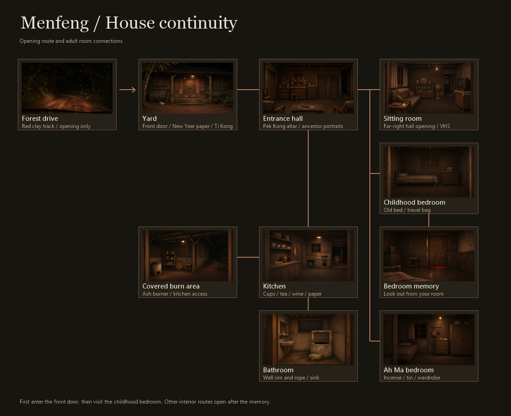

# 《門縫》

*Production game design document · Rural Taiwan · Desktop Godot · Playtest build*

**門縫** (*Ménfèng*) is the gap at a closed door. **門** is the door or gate. **縫** is the seam or gap. As a child you lower yourself to look under Ah Ma’s door. As an adult you open your eyes on the gap between the living and the dead. Both times the player chooses to look.

## 1. Build contract

A linear, first-person analog horror visual novel that the player explores by clicking through a traditional wooden house. The player returns after Ah Ma’s funeral, follows a VHS she left for them, and discovers what her nightly prayers were keeping in the house. The game plays at the reader’s pace. The world reacts to the completion of meaningful actions. One ending shows Ah Ma right in front of the player, with the demon Grandpa became holding her wrist chain from behind.

- **Platform and scope.** Desktop Godot, mouse-first, 16:9, one house and its immediate yard, one sitting. Estimate the full runtime after a read-through of the complete script. The expanded opening through the first incense begins with a timed prologue and continues at the reader’s pace. The complete playthrough uses fixed compositions, short fades between views, still-image edits, a wardrobe deduction, and a few brief local effects. Keep sound-led door and arrival transitions.
- **Player verbs.** Move through a named exit, look closer, take, place, pour, light, replay, and open your eyes. The player performs the preparations and discovers the story. The ritual sequence is guided and deterministic.
- **Presentation.** Photoreal AI-assisted stills, separate text, sparse VHS motion, environmental audio, and no voice acting. The player reads and explores without a timer. The wardrobe puzzle uses the physical details of one piece of furniture. Every required action has a visible label. There is no gameplay penalty for leaving an object alone or reading slowly.
- **Current phase.** Desktop Godot development. The first playable proves the childhood door peek. Continue from the milestone table in §9. The project’s AGENTS.md governs engineering and DESIGN.md governs visual conventions. This GDD governs the story, house, progression, media requirements, and acceptance criteria. When a difference affects the intended experience, bring the concrete conflict to the user.
- **One living document.** Carry this GDD and the two reference images into the repo together. Update relevant rows here when work changes. Track milestone progress in §9 and record unresolved production decisions there. Keep asset license credits in §8 or the project’s existing credits source. Use the code diff and Git for implementation history.

## 2. Story canon and what the player learns

On the red-dirt road, Dad asks about the missed funeral and reminds the protagonist about Ah Ma’s tape. Enter through the hall and speak to her at the ancestor altar beside Pek Kong’s shrine. Take a moment with the guilt of a goodbye you kept putting off. The first recording speaks to an uncertain future viewer. Dad’s note says Ah Ma asked him to arrange this day, and the tape asks for three sticks on Grandpa’s birthday. Chapter 6 confirms she arranged the visit. Until then, the work feels like helping Ah Ma with a family rite. The last recording opens only after the offering burns. Ah Ma cries, then the childhood night and breakfast, the daylight ritual, and the empty seat cut in at different points as she tells the story.

| Canon, in chronological order | How the player learns it, in the order the game needs it |
| --- | --- |
| Grandpa died of sickness when Ah Ma was 30. She raised three children by herself. | In the adult chapter, the family album by the couch shows three children growing up with Ah Ma. A note on the back of Grandpa’s portrait states he died after an illness. A short caption supplies Ah Ma’s age. Include one line connecting the three children to her daily work after he died. |
| By 45, all three had moved away for work. One went to Singapore. The others, including your father, went to larger cities in Taiwan. At 46, a year into living alone, she sought a ritual practitioner. | A montage of three departures in the album uses the same entrance frame. The photos thin out. A later taped memory supplies the destinations and connects the empty house to her decision. Use a caption at the moment the last photograph leaves frame. “Your father took work in the city. One of the others went all the way to Singapore. By forty-five, I was the only one left here.” |
| The practitioner promised to call Grandpa back and open Ah Ma’s sight. In the story’s afterlife, Grandpa had endured the Asura and hell realms and was on his way toward heaven and eventual rebirth. The rite interrupted that passage and brought him back as a starving ghost. | Chapter 4 connects the empty house to her decision and explains why only she could see him. A held image in Chapter 4 shows Ah Ma across from the practitioner with her eyes closed. Two short caption cards carry what the images alone cannot convey. “He told me I could see him again.” Later, “Your grandfather had finished suffering. I called him back before he could move on.” A second caption card makes the family’s cosmology explicit. “Through the Asura realm. Through hell. He was on his way to heaven and another life. I brought him back hungry.” |
| Only Ah Ma could see and speak with him. He was company at first. Hunger and resentment grew. The practitioner demanded nightly prayers and the burning of fetal remains to keep him present and pacify him. Ah Ma kept paying that price for decades, burning thousands of fetal remains. Grandpa devoured their souls and eventually became a demon. The ones that escaped him still hide in the house. Over time, he began sounding like the children he had consumed. | An early tape still matches the childhood couch frame. On the tape, Ah Ma looks into the empty seat and waits. A drawer holds hospital appointment slips spanning decades. Near the end, her tape directly connects the checkups to the offerings, along with one dated early slip and a stack of later slips. The means by which she obtained the remains stay outside the frame. A mandatory caption connects the clues. “I used to tell you they were checkups. The hospital trips were for the offerings.” |
| By her early 80s, the nightly offering can no longer hold him. Ah Ma is found in the old well, and Grandpa keeps her soul in the house. | She records what her hands had started doing. Dad’s account and fresh scrapes inside the rim supply the rest. The seated reveal shows her soaked clothes and the chain. |
| Ah Ma made the tape for her favourite grandchild before she died, after she realized he would keep her in the house. She hoped you would see her and buy enough time to reach her. | Father’s note introduces the tape. Ah Ma reveals the real purpose only after the vessel is found. She admits that starting with incense and tea made it more likely you would stay. Her last message is written in her own hand and held up to the camera. |

The timeline spans roughly 35 years of offerings between age 46 and her early 80s. Use the approved approximate ages in art and writing. Lock specific dates before generating any prop with visible dates.

Keep the family’s altar layout and vocabulary as given by the user. Pek Kong is at the entrance altar, Ti Kong is outside, and the ancestors’ and Grandpa’s pictures are on a separate ancestor altar beside Pek Kong’s shrine. All story prayers, offerings, and ritual actions at an altar use the ancestor altar. Pek Kong’s shrine is a separate inspection. Use **香爐** for the incense burner and Ah Ma’s “阿嬤只是在拜拜啦。” (“Ah Ma was just praying.”) in the childhood line. The practitioner’s summoning, required offering, forehead mark, and rules for Grandpa are part of the fictional family story. Art should render the familiar devotional objects with care. The horror comes from what Ah Ma agreed to and what Grandpa eventually did.

## 3. House and navigation

Use this adjacency map for all house art and navigation. The forest drive is an opening shot before the yard. The yard’s sole exit is the front door. The childhood shot and the floor-level peek look outward from inside the player’s bedroom. Close-ups stay in their parent room.

The author’s MenFeng Guide sets the exterior and entry-hall blocking. Use the [front house sketch](references/guide-front-house.png) and [entry hall sketch](references/guide-entry-hall.png) for object placement.

~~~text
Forest drive → Yard and Ti Kong ── Entrance hall and altars
                                     ├── Childhood bedroom and memory
                                     ├── Ah Ma’s bedroom
                                     ├── Far-right opening → Sitting room and VHS
                                     └── Kitchen ┬── Bathroom
                                                 └── Covered burn area
~~~

| View | Exits | Visible anchors and interactive objects |
| --- | --- | --- |
| Yard | Entrance hall | Unpaved red-dirt forest track, rain at arrival, Ti Kong, front door with torn old Chinese New Year paper, neglected timber exterior |
| Entrance hall | Yard, childhood bedroom, Ah Ma’s bedroom, kitchen, sitting room | The left ancestor table has a rear shelf for the family photos and an open front surface. Pek Kong’s narrower shrine stands separately to its right. The kitchen door stays at far left. The two doors beside the shrines lead to your bedroom and Ah Ma’s bedroom in that order. The far-right opening leads to the sitting room. |
| Sitting room | Entrance hall | Couch with two worn places, family album, portrait of Grandpa in a cabinet, CRT and VCR, father’s note |
| Childhood bedroom | Entrance hall | Old bed and the protagonist’s travel bag. During the memory, look back toward the closed bedroom door from the bed, then down at the gap. |
| Ah Ma’s bedroom | Entrance hall | Dresser with incense and closed tin, hospital slips, wardrobe that will hold the child-shaped vessel |
| Kitchen | Entrance hall, bathroom, covered burn area | Tea, wine, three small cups, one shelf with folded prayer paper |
| Bathroom | Kitchen | Old tile, sink, round household well with a concrete crossbar and frayed rope, wet stone step |
| Covered burn area | Kitchen | Ordinary burner, ash, hard red spill from the house, view toward the woods |

Guide the first hall visit to the ancestor altar. The bedroom, kitchen and sitting room retain their ordinary room routes from the first visit. Chapter 6 interrupts the tape with the childhood reverse angle. **Look under the door** opens the floor-level close-up, then breakfast. Later lines trigger the yard ritual and the empty seat. Resume the recording after each recollection.

**Room art continuity.** The yard establishes the tile roof, timber siding, torn New Year paper, Ti Kong burner hung above the threshold, Menshen panels on both sides, and Lucky’s bowl and chain by the tree. Once inside, the Pek Kong altar faces the player. The two bedrooms sit to its right, beside the far-right opening to the sitting room. The player’s striped blanket and travel bag are visible in the present bedroom and its reverse angle in the memory. The memory’s latch and red seam match the floor-level peek. Only exits listed above get hotspots. The well is seen from the kitchen-side doorway. The family once drew household water here. The tiled washroom was built around the well, and the sink came later. The covered burner shares the yard’s siding and red clay. The same lidded barrel is visible past the kitchen opening. Use the [well photo](references/restroom-well-reference.jpg) for the round rim, concrete crossbar, and rope. Match the concrete to the house with damp, patchy gray-brown cement and moss at the foot. The present-day plates are lit for night at source. The analog filter shapes texture and motion.

The current starter views live in [assets/opening](assets/opening). The six remaining adult backgrounds live in [assets/house](assets/house). The image thumbnails above are a continuity reference for development. The route chart and exit table govern click targets when navigation is implemented.

### Entrance hall placement through the ending

The production view is `assets/opening/hall-ancestor-table.jpg`. Keep the same room composition for every stage. Add objects on the ancestor table through game state. Composite placed objects in the backdrop shader’s `sample_room` function so the same softness, color bleed, inspection blur, and animated grain affect the objects and the room. Approximate centers below use normalized coordinates on the source image. The gameplay target can extend around the art so players can click the table comfortably.

| Story beat | Destination and visible change |
| --- | --- |
| Arrival and speaking to Ah Ma | Her frame and the old family photo sit at the left of the rear shelf. A portrait-width space beside her and the bare front boards are visible on arrival. The separate cabinet with red lamps identifies Pek Kong’s shrine. |
| Incense | The ash opening of the existing left-side ancestor burner is at (0.257, 0.479). Three sticks appear there when placed. Embers and smoke persist after lighting. |
| Grandpa’s portrait | The family frame stands at the right side of the rear shelf, centered at x 0.373 with its base at y 0.468. This is the vacant spot the player sees on arriving. It stays visible for later rites. |
| Cups, tea and wine | Put three small cups in one row on the bare front-right boards, near x 0.32, 0.365, and 0.41 with their bases near y 0.528. Pour into the cups and show fill changes. The row leaves the incense burner and both sides of the portrait readable. |
| Paper and vessel | The route leads through the kitchen to the covered burner. Place the vessel and folded paper there for the burn. The well and the bathroom reveal stay on their own sightline. |
| Forehead mark and ending | The mark goes on the player’s forehead while facing the ancestor table. The completed altar remains in place. After the burn and final tape, the reveal happens from the sofa. |

Built-in ImageGen edited the previous hall plate, preserving the doors and fixed view. The brief specified a wide empty ancestor tabletop, a vacant frame spot on the rear shelf next to Ah Ma, a single empty ancestor burner to the left, and a distinctly separate, narrow Pek Kong shrine. The three cups and separate drink fills use the same room shader as the incense and portrait. A clean kitchen plate carries independent source sprites so each object goes away on pickup.

## 4. Playthrough specification

### Direction for the writing and pacing

- **Arrival to the first incense.** Let the player learn the rooms and grieve before the supernatural has an image. Begin with Dad’s call, the apology at the ancestor altar, and the tape’s birthday request. Let the ordinary ritual work carry the first small deviation at the edge of a doorway. [Banjong on pacing in *The Medium*](https://www.koreaherald.com/article/2648937)
- **Respects to the jar.** Dad and Ah Ma show care through small jobs. Start the first tape with a greeting and something she expects the grandchild to have done, such as coming in with wet shoes. Keep the everyday actions short and let a later sound change what an earlier action meant. Red Candle builds *Devotion* around a Taiwanese family and the rooms they lived in, and Chilla’s Art uses a familiar shift in *The Closing Shift*. In MENFENG, let the third cup, the empty couch, and the rope carry the questions between tape chapters. [Red Candle Games’ Taiwanese *Devotion* press kit](https://redcandlegames.com/presskit/sheet.php?l=ch&p=devotion), [Chilla’s Art’s *The Closing Shift*](https://store.steampowered.com/app/1843090/The_Closing_Shift/)
- **Confession to blackout.** Let the player open the jar before Ah Ma tells them what it held. She admits what she kept from the family and pauses before asking the grandchild to stay. *Incantation* makes a mother’s plea to the viewer part of the horror, and Na Hong-jin grounds *The Wailing* in a parent’s need to protect his child even when the apparent explanation changes. In MENFENG, the grandchild follows the laugh after learning what the powder has done. Ah Ma and Grandpa return the look. Cut on their only line. [Kevin Ko with Netflix](https://about.netflix.com/en/news/taiwans-horror-blockbuster-incantation-brings-terror-to-netflix-on-8-july), [Na Hong-jin’s Cannes pressbook](https://cdn.festival-cannes.com/media/uploads/2023/03/47084.pdf)
- **Read each beat out loud.** Give the speaker an immediate reason to say it. Keep the English translation as easy to say as the Traditional Chinese. Let Ah Ma use family terms and familiar phrasing such as 阿嬤, 阿公, 拜拜, and 食飽未. Keep first-person thoughts short and save the speaker label for people speaking. Leave a beat silent where the picture, sound, or the player’s click already tells it. [John August on writing dialogue](https://johnaugust.com/2007/how-to-write-dialogue), [Frictional Games on when to leave a gap](https://frictionalgames.com/2017-06-gaps-of-the-imagination/)

Time ranges are pacing targets. Story progression depends on completed interactions. The title leads to a black screen where 前人栽樹，後人乘涼。 fades in with its English translation. The glitch starts at eight seconds, the characters settle on the red 前人種禍，後人遭殃。, and the warning holds for five seconds before the drive. Tell the arrival one line at a time. Clear narration for inspection after the yard and hall introductions. Pointer or keyboard focus reveals the object label. Show small clues as transparent cutouts centered over the softly blurred room. Use a short zoom for fixed features such as the well. Both layers share the analog treatment. The full front door opens on click. Returning to a room after its introduction opens its hotspots directly.

| Beat | Entry and required clicks | Feedback and next state |
| --- | --- | --- |
| **1. Arrival and respects** | Take Dad’s call, inspect the yard and enter the hall. Speak to Ah Ma at the ancestor altar. | Learn the controls and the layout. Let the apology land before the VHS. |
| **2. The tape** | Go to the sitting room, read Dad’s note and play Chapter 1. | The tape is marked for the grandchild but speaks conditionally about the day. The birthday request feels like a favor. |
| **3. Incense and portrait** | Find incense on the dresser and matches in Ah Ma’s market bag. Hold, place and light the incense. Play Chapter 2, check Grandpa’s portrait and place it. | A head peeks silently from the right doorway for 1.65 seconds after the incense scene. A later standing figure holds for 1.65 seconds before the hall-to-kitchen fade. Both are transparent sprites on the existing hall. |
| **4. The three cups** | Set out the cups. Use the clue from Ah Ma to pour rice wine into Grandpa’s chipped cup, then tea into the other two. Take the joss paper and inspect the covered burner and well. | Each cup records its own state. A wrong pour attempt leaves the drink in hand. After the first successful pour, footsteps and a slam come from the house. |
| **5. Vessel** | Chapter 4 points to the wardrobe. Read the seam, find the wedge in the woven box, and lift and brace the shelf by the cloth tab. Read the slips, take the vessel, set it down at the burner and look inside. | Footsteps get closer while the player works. The game leaves time to think and keep trying. One figure is visible during a later departure from the hall. |
| **6. The last instructions** | Chapter 5 tells the player to inspect the well, take the tin, put the powder on their forehead at the ancestor altar, and burn the paper with the jar. | The well’s traces connect to Dad’s note. What the mark does stays unclear until the last recording. |
| **7. The confession and the laugh** | After the fire goes out, watch Chapter 6. Ah Ma breaks down as memories of the door, the daylight ritual, and the empty seat interrupt the recording. The tape ends after her apology. | Hear a laugh to the left, then choose to look. The two figures look back in silence. Cut from the final line to black, scrolling credits, and the end card. |

**Tape and route rules.** Tape chapters unlock once their current objectives finish. At the CRT, the player can revisit any completed chapter through **Earlier chapters**. **Replay last instruction** presents the latest available instruction without reopening the footage. Captions stay visible until the player advances. Later chapters stay concealed until their beat. Show an available new chapter on the objective line and in the TV hotspot label. Each required item has one home. Early inspection shows that prop in place and lets the player describe it. Where picking it up early would spoil the revelation or change the altar sequence, show a short prompt tied to the current task. When a chapter points the player somewhere new, its last instruction names the room and the object. An optional hint can state both again.

**Object rules.** Taking an item stores it in the inventory accessed from the top-left of the room view. Dim the room behind the inventory and hide the gameplay HUD. Show the selected item’s transparent image, name, and description at left, with **Hold item** or **Put away** below. Display only occupied rows on the right, with a red dash for the current preview and **Held** on the equipped item. Open to the held item or the first collected item. An empty inventory shows an empty message and **Back**. Holding or putting away an item returns to the room. Clicking its intended destination places it and removes it from the inventory and hand. Cups move as a group. Tea and wine are two labeled pours with visible fill states. Their earliest draft order may be either. The playable draft puts tea in the two outer cups and rice wine in the middle. Both pours work in either order. Confirm the family’s preferred layout before locking the altar art. Once a prop is placed, revisit the source and destination to verify it appears in only its correct place. Correct actions commit once. Repeat clicks on completed objects reopen their description. The paper and vessel are consumed by the one authored burn. The altar lamp persists during and after the sequence.

**Wardrobe puzzle.** The loose bottom panel drops when lifted by the red tab. The player finds a wedge in the woven box and uses it to hold the panel up, exposing the documents and jar. The footstep sequence advances while the player is in the closet view. Leaving the room stops the cue, and opening the shelf preserves progress.

**Ending treatment.** After Ah Ma apologizes, the recording stops. Grandpa laughs from the direction of the doorway on the seated player’s left. The player chooses when to turn. Start on the seated view of Ah Ma soaked and bowed, with Grandpa in profile at the doorway and the chain in his hand. Hold the still room until the laugh finishes and leave another beat of silence. In the same framing, Grandpa turns to the player and widens his smile, then Ah Ma raises her injured face. Child shadows stay low in the room. Show “Grandpa?” above “You can see us.” and cut to black. Fade in the credits for Medissl. The final card reads “The End.” and “thank you for playing :D -Medi”.

**Optional discoveries.** Metal clicks are heard during the childhood peek and again in the hall after the offering. The final chain is visible in the silent room. After Chapter 5, looking back at the bedroom doorway gives one short return to the reverse view. The sound moves to the player’s side of the door. Returning to the open wardrobe lets the player turn Ah Ma’s last receipt over and read what she wrote about a childhood visit. Replaying Chapter 1 after the preparation instructions reveals an extra line after the familiar recording finishes. These additions can be missed and never alter the progression or ending. The approach draws on domestic spaces read through recordings and on familiar media that become unreliable. [Kitty Horrorshow’s ANATOMY](https://kittyhorrorshow.itch.io/anatomy), [LOCAL58’s You Are On The Fastest Available Route](https://www.youtube.com/watch?v=jh09uIN6tl0), [Frictional Games on anticipation and offscreen cues](https://frictionalgames.com/2017-06-gaps-of-the-imagination/)

## 5. UI, captions, and tone

- **Prologue and transitions.** Hold the Traditional Chinese proverb and its two-line English translation for eight seconds. During the 2.98-second user-supplied speaker glitch, scramble a few of the Chinese characters in place as they resolve into the warning. Fade the English proverb out as the sound begins. Fade the English warning in during the last part of the scramble so both languages are fully visible when the hold begins. Hold the red warning for five seconds, fade it out, then fade in the forest road. Both cards use Noto Serif TC and Crimson Text. The prologue uses a small Noto Serif TC subset covering the Traditional Chinese text. Use the scene curtain for room, memory, and TV transitions. Block repeated input while a transition runs. The car and door sounds lead their views by the existing timing. The intro uses the supplied `Glitch Sound Effect (Speaker).mp3`, decoded to PCM and trimmed to the audible burst in `assets/audio/intro-glitch.wav`.
- **Opening manuscript.** The mandatory beats live in `scenes/opening_story.gd`. The drive starts with a monologue, then the handset rings. The answer action plays the existing pickup sound. Dad and the protagonist speak in Traditional Chinese above English subtitles. The bedroom follows the same tucked blanket into the memory, and the first VHS gives Ah Ma time to tell her own history. After lighting the incense, the smoke recalls the empty cushion and gives the player a reason to go back to the TV. Optional object interactions add ordinary household memories. The first sweep adds the rain barrel, tea tray, standing fan, and market bag.

- **Title and settings.** Keep the closed bedroom door and its thin red seam. Set **門縫** in dark cinnabar Noto Serif TC with small ivory **MENFENG** below. Align **Begin**, **Settings**, and **Quit** at left in Crimson Text. Title settings retain the door. Pause freezes the current room crop or TV frame. Master, Music, and SFX volume sliders appear over a dark fade and save between runs. SFX controls environmental sound as well as individual cues. Settings has **Back**. Pause focuses **Resume** first and places **Return to title** beneath the settings. Keep the corners clear in both overlays. Put the content notice in the first Begin flow. The working script is in English with the family’s terminology. Ah Ma’s tape and her breakfast reply present Traditional Chinese with an English translation.
- **Exploration.** Use pictured objects and doorways as the main hotspots. On hover or keyboard focus, show a small ivory label beside the object. The full front door opens directly. Inspect the paper decorations on the side separately. Use an open-pocket icon with **Inventory** at upper left and a thin diamond around the **Menu** icon at upper right. Center the current objective near the bottom. When the player holds an item, use its data to display **Holding three incense sticks** or the current equivalent under Inventory. Label the burner **Place incense** only when clicking will place the held incense.
- **Narration and inspection.** Center ivory Crimson Text in the lower reading area over a black fade. Keep each beat to one or two short lines where possible. Place a named speaker or an italic sound cue above the line when applicable. First-person thoughts have no speaker tag. Use a small centered **Continue ⌄** across rooms and VHS. Click the reading area or an unoccupied part of the scene, or use Space or Enter when the reading area has focus. Click during the typewriter reveal to finish the line. The next click advances it. Inspections use the same layout, and small items have transparent close-ups over a blurred room. In-world hotspots handle navigation when the doorway is pictured. Use a bottom-edge **Go back** hotspot for rooms with a return route. Reveal its label on hover or keyboard focus and hide it while reading. Put the peek hotspot on the red gap itself. Show explicit item actions in the bottom-center reading area.
- **Tape.** Clicking the television or VCR cuts to a seated view facing the dresser. Map the 4:3 recording and its timecode to the curved TV glass with scanlines, grain and tracking distortion. The cabinet and room retain the quieter scene filter. One hotspot at the physical deck supports **Play tape**, **Pause tape**, **Resume tape**, and **Replay tape**. It reveals its action on hover or keyboard focus. **‹ Stand up** at lower right returns to the sitting room. Use one to three photographic stills per segment. Center the Ah Ma speaker label below the TV. Present her Traditional Chinese dialogue in Cubic 11 with a smaller English translation beneath. Reveal and advance both together with the shared Continue prompt. [Cubic 11](https://github.com/ACh-K/Cubic-11/tree/v1.500)
- **Readability and pacing.** Keep subtitles and effect captions readable in silence. The shared pause menu and title settings expose Master, Music, and SFX volume. Use click-to-advance at plot-critical captions. Progress clues stay readable in silence. Double clicks during cuts and returning from pause can never skip a story trigger.
- **Ending/reset.** The final reveal is followed by **Continue** and then a return to the title. A new session restores the untouched room, first VHS chapter, and opening rain cues. Measure the final run with reading and optional inspection included. If the supplied project already has a tested checkpoint mechanism, reuse it. Otherwise the first playable needs pause and restart.

Build the UI with the project’s existing Godot nodes and theme patterns. If a layout needs establishing, a fixed 16:9 design canvas with aspect-preserving scaling lets the background and hotspot bounds stay together. Check 1280×720, 1920×1080, and a non-16:9 window with safe letterboxing. [Godot multiple resolutions guide](https://docs.godotengine.org/en/stable/tutorials/rendering/multiple_resolutions.html)

## 6. Progression and state

Keep the current main stage, current view, collected/placed items, and tape progress in one owner. Use a small fixed sequence in the project’s existing script style. Derive visible props, available exits, and enabled actions from that state. A modal close-up, the pause menu, and the tape player may hold temporary UI state.

| Main state | Completion condition | On completion |
| --- | --- | --- |
| Arrival and childhood flashback | Drive, enter through the front door, inspect the childhood bed, peek under the door, and read the breakfast memory | Return to present-day bedroom and open the remaining hall routes |
| Speak to Ah Ma | Address her at the ancestor altar, read father’s note, finish VHS chapter 1 | Enable taking and lighting incense |
| Incense | Place and light incense in the burner | Unlock VHS chapter 2 |
| Portrait | Finish chapter 2, view the album, inspect and place Grandpa’s portrait | Unlock VHS chapter 3 |
| Offerings | Finish chapter 3, place cup set, pour tea and wine, take prayer paper, inspect burn site and bathroom well | Unlock VHS chapter 4 |
| Vessel | Finish chapter 4, lift the false wardrobe board, take the vessel, read the slips, set down the vessel and look inside | Unlock VHS chapter 5 |
| Preparation | Finish Chapter 5 and inspect the present-day well rim | Enable taking the chalk-like material |
| Sight | Mark forehead at the ancestor altar, place paper and burn the offering, return to VHS | Unlock VHS chapter 6 |
| Final look | Finish the confession and its memories in Chapter 6, hear a laugh to the left, and look toward the doorway | Reveal Grandpa and Ah Ma. The last line leads to the black hold, credits and end card |

**VHS chapters.** Chapter 1 welcomes the player and names the incense. Chapter 2 sends the player to the small portrait inside the sitting-room cabinet. The family album and her note on the back supply Grandpa’s history. Chapter 3 requests the cups, drinks and paper. Chapter 4 shares Ah Ma’s memories of the family leaving and sends the player for the vessel. Chapter 5 gives the final instructions. Chapter 6 reveals what the player’s actions meant through Ah Ma’s tearful confession and three separate memory cuts. Facts owing an explicit line are in §2. For replay, keep all completed chapter captions available from **Earlier chapters** on the CRT. **Replay last instruction** opens a caption with the most recent instruction from any view. Pressing **Back** restores the same view. Replaying a chapter changes no game progress.

When the adult can explore, the entire house is navigable. Exploration before an item’s stage gives an inspection with minimal description. The three cup positions and foreground art can be placed before deciding the final tea and wine split. Treat the group as complete when both pour actions are satisfied. For the burning sequence, show **Set down vessel** before **Look inside**. Once the mark is applied, the covered burner exposes **Place paper**, then **Burn offering**. Each dialogue advance or action consumes one click. While a cut is in motion, the initiating click is consumed and the next action waits for release.

The adult room changes persist across navigation and VHS playback. One-shot cues fire at the first valid transition. Reopening a view can restart its room ambience with a fade and can display its current image. Test early discovery, backtracking from the burn area through the kitchen, repeated clicks, replay, and restart. Use the Godot version and project conventions found in the provided repository before choosing node or file names. Built-in scene nodes, anchored Control hit regions, texture layers, and AudioStreamPlayer are enough for the first pass.

## 7. Visual production and AI asset guide

### Visual references

1. [Warm altar reference supplied in chat](references/warm-altar.jpg). Use red practical lights, hard amber accents, near-black devotional objects, dark carving, brass, and a crowded but deliberate altar silhouette. Preserve enough midtone detail to read the burner and offerings.
2. [Cold tape reference supplied in chat](references/cold-tape.jpg). Use a head-on framed altar, charcoal background, desaturated grey-green casts, dim figures, soft highlights, and a low-resolution photographic surface. Use the composition and tone to distinguish old tape from the live room.

3. [Grainy kitchen reference supplied in chat](references/grainy-kitchen.jpg). Use the image area for shadow noise, uneven exposure and how the darkness absorbs detail.

4. [Analog-TV altar reference supplied in chat](references/analog-tv-altar.jpg). Use this for the texture and color bleed of old TV. Use ink-black negative space, small jewel-blue light sources, crisp silhouettes with soft low-resolution edges, and restrained color bleed.

Generate original, matched photographic stills from the established house layout. Keep a restrained palette that fits each room. For the opening, use charcoal and weathered brown, with a thin scarlet seam and practical room light. Preserve a clear difference between lit details and black pockets. Use the Noto Serif TC title and ivory Crimson Text for the menu and narration. Use the layouts in §5 and the six [UI references](references/ui-analog/CODEX-HANDOFF.md). Use a short ivory underline for menu hover and keyboard focus. Reserve the red dash for the selected inventory row and the held-item cue. Show sound cues in italic text above the narration, in the same reading area. Hold them through the relevant line so the sequence reads with sound muted. Name the location or source when it is part of the evidence. Use VCR OSD Mono as the reference for tape overlays inside the CRT. Bundle that font only after verifying the creator’s redistribution terms.

Use first-person narration to supply memories and relationships the frame cannot show. Let objects establish clues through inspection, and leave the image on its own between beats when the picture or sound already carries the moment. Keep Ah Ma’s captions below the TV and the tape status and timecode inside the glass. References for short personal narration, object-led folk horror, and text inside an in-world interface. [Fears to Fathom: Carson House](https://store.steampowered.com/app/2120900/Fears_to_Fathom_Carson_House/), [The Excavation of Hob’s Barrow](https://wadjeteyegames.com/games/the-excavation-of-hobs-barrow/), [Home Safety Hotline](https://store.steampowered.com/app/2357910/Home_Safety_Hotline/). For the click-to-read convention and optional speaker labels, see [Ren’Py’s dialogue and narration reference](https://www.renpy.org/doc/html/dialogue.html).

Use the shared Godot backdrop shader for low-resolution softness, restrained saturation, mild lens distortion, horizontal color bleed, and image grain. Tune the picture in engine before baking additional degradation into any image. Apply the filter to scene photography. Keep labels and controls sharp. The grain updates at ten frames per second in the picture. Captions and controls stay sharp and still. During the memory, a slow bend in the picture and a moving shadow in the red spill provide motion. The opening keeps a clear frame edge. Reserve stronger contrast, manipulated features, and brief signal interruption for authored story moments such as the in-world tape or final reveal.

### Asset budget and construction

| Family | First production pass | Continuity and checks |
| --- | --- | --- |
| World backgrounds | Nine clean adult backgrounds plus the forest drive listed in §3, composed for a 16:9 canvas. Work at 1920×1080 or higher at source where available. | Both sides of every usable doorway match. Keep an obvious exit landing area. Make each key item clearly identifiable at 1280×720. |
| Memory and opening | One child-height reverse angle from inside the bedroom, a matched door-gap close-up, one breakfast frame, one couch vignette and one additional short conversational vignette. Use edits or crops of accepted room views where the perspective permits. | Same door planks, seam, wear marks and room layout in both eras. Child height, daylight and weather may change. |
| Prop images | Incense, incense burner, Grandpa’s framed portrait front and back, cups, tea and wine, prayer paper, hospital slips, chalk-like material, closed and opened child-shaped vessel, and the well and its rope. | Use close crops where adequate. Use transparent layers or local patches for movable props, filled cups, removed items, and the vessel lid. Author every date and character as editable text. |
| VHS | Six chapters with one to three stills each. Reuse the accepted room masters and stable Ah Ma references. Use separately composed inserts for the practitioner, old album, and handwritten message. | Ah Ma has a stable face, wardrobe and age for each era. Photograph ordinary gestures and let a held frame create discomfort. Use the shared grain and exposure baseline. Apply the tape framing and transport overlays in Godot. |
| Horror changes | Lit incense ember, house watcher glimpses, daylight yard memory, well traces, and seated reveal. | Composite brief doorway glimpses into the room before analog sampling. Preserve the outlines of the hand, chain, and wet figure through the subtle final glitches. |
| Interface | Minimal Godot theme, title treatment and cursor states. | Use native controls and editable text. Keep focus indicators and caption backgrounds outside the image degradation effect. |

### Generation sequence

1. **Block the whole house using the map and room stills in §3.** Fix the door, altar, couch, CRT, bedroom cupboard, basin, bathroom well and sheltered burner before authoring hotspots. Use the map to check both ends of each planned link.
2. **Establish the house and VHS look frames.** Use the opening passage and peek to check the original room lighting and the behavior of the shared picture filter. Test the altar’s warm practical light and a cold frontal VHS composition with the same house fixtures. Check grain survival and prop readability in an actual game capture at 1280 × 720.
3. **Build references for the recurring people and key props.** Lock Ah Ma at childhood-visit and recorded-tape ages, Grandpa in the family portrait, and the final face as the same man after years of hunger. Lock the door wear pattern, incense burner profile, CRT model, vessel silhouette, and the well and its rope against the floor plan.
4. **Generate adult room masters from that layout.** Use the validated hall as the reference for adjacent views. Sketch the framing before each generation. For a later state, submit that exact approved background as the edit target and change the smallest possible region. Preserve the source master and named crop.
5. **Add close-ups and states.** Crop existing frames where possible. Composite prop changes with separate layers. Test removing objects from sockets, pouring, and placing at the altar. Leave blank text areas on photographed slips, notes, and plaques. Add approved Traditional Chinese separately.
6. **Integrate and inspect real captures.** Compare adjacent views and before/after pairs at 1280×720. Check the door-gap callback, a built-up altar, the vessel inspection, and the ending at native game scale. Reject drifting geography, altered props, unreadable characters, or impossible light geometry before polishing. Store only selected runtime assets in the repo and keep private prompt references with the project materials as appropriate.

**Inspection cutouts.** The built-in image generator used each corresponding room as a material and lighting reference. The eight briefs isolate the side door-god print and New Year paper, Lucky’s bowl and rusty chain, tabletop family portraits, open album and folded note, incense packet and white-rimmed tin, three cups with a tea jar and wine bottle, folded joss paper, and suspended Ti Kong burner with chains. Each brief specifies an alpha background with no surfaces or lettering, aged earth tones, soft practical light, and padding around the silhouette. The shader supplies analog noise after compositing.

**Prompt recipe.** State the room and adjacent landmark, era, camera height and target framing, what the player must be able to see or click, source of practical light, house materials, and whether the reference is an edit target or a mood reference. Specify practical light, distinct dark silhouettes, neutral materials, a usable exposure range, and the room’s color accents. Use the shared shader for consistent signal treatment. Keep subtitles and tape transport controls separate. For states, specify the one desired change, its location, and the stable camera and objects around it.

**Example master brief.** “Rural Taiwanese traditional wooden home after dark, just after rain. Static first-person view facing the established hall layout. Two distinct surfaces are visible on entry. Pek Kong sits in his shrine, and the neighboring ancestor table to its left holds family portraits and a separate brass burner. The passage stays unobstructed on the right. A faint practical lamp reveals the altar. Dark windows, plain timber and readable object edges. Soft, ordinary pre-digital snapshot, 16:9. Preserve room layout in later edits. Leave legible writing to typography.”

**Example state edit.** “Use the approved entrance hall still as the edit target. Put the approved three-cup group on the marked tray. Keep the camera, burner, plaques, portraits, lighting, and shadows elsewhere in the room as in the source. Leave the space for Grandpa’s portrait exactly as drawn in the blocking.”

Use one import preset per practical media class where that works. For final images, an opaque compressed format is useful for backgrounds and lossless PNG is suitable for transparent layers and fine prop detail. Check the actual import options in the provided Godot version. [Godot image and texture importing guide](https://docs.godotengine.org/en/stable/tutorials/assets_pipeline/importing_images.html)

### Performance of the scares

Keep the first half grounded in familiar work. After the first incense there is one short head peek. In the middle, the party to the ritual only hears children and footsteps. One later transition briefly exposes a shape in the hallway. The memories and full explanation belong to Chapter 6, after the offering. After the fire, return to the familiar seat and let the offscreen laugh invite the turn. [Pisanthanakun and Na on The Medium](https://www.patsonic.com/movie/the-medium-interview-nahongjin-banjong/), [Ko on Incantation](https://about.netflix.com/en/news/taiwans-horror-blockbuster-incantation-brings-terror-to-netflix-on-8-july), [Na on The Wailing at Cannes](https://news.sbs.co.kr/news/endPagePrintPopup.do?news_id=N1003586269)

- **Door gap.** Let the player approach, inspect the floor, and click to lower the camera. Show the red line before the shape behind it. Use a practical lamp, a slight shadow change, and the sound of breathing cloth near the floor.
- **Couch.** Ah Ma’s eyes settle on the empty place. Hold that image a beat after her line leaves the screen. Match the adult framing so the worn second seat answers the earlier moment visually.
- **Offerings.** Use ordinary tasks to set the pace. After the first kitchen pickup, give the player a moment with the object before a short, distant laugh. After the first pour, wait for the liquid sound to finish. Footsteps cross the boards, then a door slams at the far end. Play each cue once. Captions describe the sound and its direction. The empty rooms and tightly drawn well rope leave the player to interpret what they heard. Keep the children’s identity, what happened to them, and why they fear Grandpa for the end. Chilla’s Art’s shift-work premise informed the use of familiar tasks as setup. The foley team’s GDC talk informed the use of directional sound for tension. [The Closing Shift](https://store.steampowered.com/app/1843090/The_Closing_Shift/), [Foley in Alien: Isolation](https://www.gdcvault.com/play/1023223/Foley-in-Alien-Isolation-Gears)
- **Vessel.** Let its weight register in the handoff to the burner. Show several shapes through a small opening under the lid. The tape names what is inside. Keep the player’s attention on Ah Ma’s choice and their own next click.
- **Ending.** Make one coherent doorway, head and hand silhouette. Give the jaw enough structure for the uneven smile to attach to the face. Show a continuous chain to Ah Ma, low wet hair and small child shadows around the room. The camera has turned left from the television, and the source plate retains readable dark detail for the two small tracking slips.

## 8. Sound production without voices

Use room beds and practical textures as the score. Narrative voices stay in text. In childhood, show Ah Ma’s measured posture and breath, and use a caption such as **[Ah Ma chants under her breath]**. Give the scene wood, cloth and night ambience. The tape’s last instructions come through authored captions and a written card.

| Cue | Where and when | Sound search or edit brief |
| --- | --- | --- |
| Exterior rain and rural night | Arrival, then quieter after entering. Rain stops once the player has reached the hall. Leave water dripping from the eaves. | Rain on tiles or roof, distant wind through trees, wet leaf drip. Build one exterior bed and use filtering or volume to separate interior. |
| House at rest | Adult rooms and childhood holding shots | Low timber tick, cloth, sparse insects from outdoors. Keep the bed quiet enough for distinct single events. |
| Threshold | Opening peek and adult callback | A faint wood shift and soft cloth movement with a clear source. Let the second version lose part of its ambient bed. |
| VHS | At physical Play, Pause, and chapter ends | VCR button click, transport start, brief analog hiss and stop. Use subtle filtering to keep the sound inside the television. |
| Offering work | Incense placement, cup set, pours, paper, burner | Ceramic against wood, match strike, quiet tea pour, paper handling and small ignition. Each click receives a grounded response. |
| Vessel and bathroom | Vessel placement and well traces | Heavy ceramic contact, gritty lid scrape, room-length water drips and rope scraping against wet concrete. |
| Final sight | Burn, return, hear the laugh, look toward the doorway | Let the fire die down and pull the house bed back. Start the supplied laugh to the left as the tape stops, then let the laugh die before either face moves. |

**Sourcing.** Start with Freesound CC0 and CC BY clips from an attributable uploader. Check the individual asset page and exact license before using a file. Record title, creator, direct asset URL, license and version, changes, and cue in the table below or the existing credits source. Credit CC BY assets in the shipped credits. Use licensed libraries when their terms cover the intended build, project collaboration and required distribution. For Sonniss GDC clips, check the applicable edition’s terms before use. The license distinguishes synchronized finished games from distribution of the sounds as assets. Prefer CC0 or suitable CC BY for source files that will be checked into a public repository. Download individual needed clips or approved licensed extracts during the sound milestone. [Freesound licensing guidance](https://freesound.org/help/faq/), [Sonniss GDC bundle license](https://sonniss.com/gdc-bundle-license/)

| Cue | File or clip title | Creator and source | License and version | Edits and credit |
| --- | --- | --- | --- | --- |
| Title and gameplay score | 孤键回响 | User-supplied Suno download with embedded artist `medi761` | Medissl confirmed use in the free game release. Creation plan and source link are unrecorded. | Loop and duck beneath scene cues. Quiet in the childhood memory. Drop out for the final reveal. |
| Prologue interference and incoming call | Glitch Sound Effect (Speaker) and Cell Phone Ringing - Sound Effect | User-supplied files | Source pages and licenses pending | Time the initial Chinese text scramble to the glitch cue. Bring in the call cue after the road monologue. |
| Forest drive | Car Driving Sound Effect | User-supplied file | Source page and license pending | Trim the lead-in. Play once, then loop the last 2.74 seconds across a blended seam. Fade the engine on arrival. |
| Park and get out | Car Door Open & Slam - Sound Effect for editing | User-supplied file | Source page and license pending | Trim to 4.22 seconds. Start on black. Fade in the yard about one second before the clip ends and restore narration once it finishes. |
| Wooden room doors | Front Door, Open and Close, A - Free Sound Effect | User-supplied file | Source page and license pending | Trim to 1.91 seconds. Use for the front door, bedroom doors, kitchen and washroom. Start on black and reveal the new room during the last second, so the latch lands in the new view. |
| Arrival rain | Rain Sounds 15 seconds soundtrack | User-supplied file | Source page and license pending | Blend a loop, play quieter inside the car and hall, fade out on “The rain has stopped.” |
| Childhood door gap | Woman Chant Free Sound Effects No Copyright Background Music For Videos | User-supplied file | Source page and license pending | Low-pass and trim to 7.52 seconds. Bring in the italic muffled chanting caption with the sound and hold it until the player leaves the reading beat. |
| Yard arrival | Man Coughing Sick Cough Sound Effect | User-supplied file | Source page and license pending | Play after the car-door cue. Keep *Coughing* in the reading area through “Does nobody take care of this house anymore?” |
| Exterior night | Wind blowing tree leaves, SOUND 4k uhd and Grasshopper Sounds | User-supplied files | Source pages and licenses pending | Mix into one loop with a blended seam. Let it come forward when the rain has stopped. |
| Dripping water | Water Dripping Sound Effect | User-supplied file | Source page and license pending | Loop with a quiet gap. Use close in the bathroom and faintly outdoors after the rain. |
| Album | Page Turn Sound Effect! Flip Sound Effect! | User-supplied file | Source page and license pending | Play when the player advances to the photograph in the album. |
| Front entry steps | Walk On Concrete - Sound Effect for editing | User-supplied file | Source page and license pending | Use two steps at the front threshold. |
| VHS transport | Cassete put in, Cassete playing, Cassete eject | User-supplied files | Source pages and licenses pending | Trim and prepare insert, playback, and eject cues for the tape milestone. |
| Incense and offerings | Lighting A Match Sound Effect and Short Heavy Liquid Pour Sound Effect | User-supplied files | Source pages and licenses pending | Play the match for incense lighting and the pour once for each drink. |
| Taking any item | Pick Up Item Sound FX | User-supplied Lux Aeterna Audio clip | Source page and license pending | Trim to 0.43 seconds. Play once after an item enters the carried-items row. Play nothing on inspection or repeat attempts. |

| Distant laugh | Children Laughing Sound Effect | User-supplied file | Source and license pending | Filter a 1.15-second fragment through the kitchen wall after the first pickup. |
| Footsteps and door | Run+on+wood and Door Slam | User-supplied files | Source and license pending | Use the supplied steps and softened slam after the first successful pour. Use quieter steps followed by near steps and a slam in the wardrobe. |
| Covered burner and first well inspection | Creepy Suspense and Collecting water in a well | User-supplied files | Source and license pending | Use the existing low bed under the burner close-up. Play a short hollow water sound without a caption on the first well inspection. |
| Forehead rite and finale | Shaman Rite Chant and Scary Laugh Sound Effect | User-supplied files | Source and license pending | The chant plays with the mark and sits under percussion during the yard memory. The supplied laugh is trimmed to a left-weighted cue that starts after the final recording, before the player turns. |
| Chain | Chains Sound FX | User-supplied file | Source and license pending | Trim to a short chain click for the childhood peek and the quiet hall after the offering. |
| Wardrobe and vessel | Table Move, Putting Object On Table, and Scrape Slide Wood | User-supplied files | Source and license pending | Trim to short contacts for the board lift, jar set-down and lid opening. Reuse the table contact for placing the portrait and cups. |
| Well and fire | Collecting water in a well and Paper Burning Sound Effect | User-supplied files | Source and license pending | Cut separate early and late well cues. Trim the fire to 7.40 seconds, including its decay. |
| Yard ritual | SHAMAN DRUM VS GONG ENERGY RAISING | User-supplied file | Source and license pending | Use a 12.50-second excerpt under the separate supplied Shaman Rite Chant. |
| Interface | inGameOpenMenuOrSetting sfx, hover sfx, selectoption sfx | User-supplied files | Source and license pending | Play the soft open cue on opening settings, pause or inventory. Hover is limited to menu and inventory controls. Selection confirms buttons and point-and-click actions. Protect the final reveal’s silence. |
| Room tone and later transitional cues | Room tone, couch shift, suspense swell | Existing project files | Source records incomplete | Keep the room bed below narration and use the discrete sounds during their respective scene beats. |

**Implementation.** Use Music and SFX buses routed through Master. Room ambience belongs to SFX. Audio preferences save to the local Godot user profile. WAV suits short local cues. Ogg is an option for longer loops. Trim clicks or tails where needed, crossfade room beds, and leave mix headroom. Pause stops or holds the active sounds consistently with the current screen. Muting preserves captions and visible feedback. Verify headphone and ordinary speaker playback at a comfortable volume. [Godot audio buses](https://docs.godotengine.org/en/stable/tutorials/audio/audio_buses.html), [Godot audio imports](https://docs.godotengine.org/en/stable/tutorials/assets_pipeline/importing_audio_samples.html)

## 9. Milestones and handoff

The repo and Godot project are the starting point for the tasks below. At the start of each session, read its AGENTS.md and DESIGN.md, inspect Git status and the project entry scene, read the current milestone here, and choose the smallest complete change that advances it. Use the project’s version, conventions, and existing test commands. Use a focused manual run when the project has no automated harness for the affected behavior. Preserve unrelated changes and configured project settings. The user controls pushes, merges and deployments.

| Status | Slice and dependencies | Change area and completion evidence |
| --- | --- | --- |
| [x] **1. Door-gap proof** | After project access. Make a playable title-to-peek flow with a rough passage still, a matched close-up, and one caption and cue. | Entry scene, two images and one transition. On mouse click, the red seam and perspective read immediately. Pause and return work. Capture the rendered view and watch at 1280×720. |
| [x] **2. Arrival and explore** | Connect the room views. Reach the TV from the yard via the ancestor altar and Dad’s note. | Room navigation, objective line, and working tape transport. |
| [x] **3. First ritual action** | Play chapter 1, take incense, place it, and light it. | Carrying, placed, and lit states. Revisiting preserves the lit incense and the empty dresser holder. Chapter 2 becomes available at the CRT. |
| [x] **4. A complete rough cut** | After 3. Connect portrait and album, then cups and paper. Verify that section. Connect vessel, mark and burn, then the final confession and look. Verify each adjacent pair of beats as it lands. | Main-stage logic and authored beats, with placeholder media. Complete a silent mouse-only run from title through the one ending, backtrack, restart, and check that mandatory story facts and all controls are present. Record the rough-cut runtime. |
| [x] **5. Matched art** | After 2 for test frames and after 4 for batch integration. Do the paired art test before editing or generating the rest of the house. | Assets and per-view art placement. Accept the warm hall and cold tape pair before expanding. Compare the runtime stills against §§3 and 7. Playtest the opening and ending on a dim display and inspect the vessel and portrait at minimum size. |
| [x] **6. Ambience and pacing** | After 4. Source and import the minimum cue set. Tune the final look after 5. | Audio imports, buses, scene cues and the existing credits. Verify loop seams, captions, credits, audio on/off, and no duplicate cue on revisit. Compare room transitions and final silence on headphones and speakers. |
| [x] **7. Final integrated review** | After 5 and 6. Verify the chapter and export only if authorized within the project task. | Fresh start and clean playthrough, slower caption reading, repeated clicks, non-16:9 frame, muted mode, and restart. Check the working diff, Godot errors and the project’s relevant checks. Keep rendered evidence in the existing workflow. |

**Current build.** The six tapes lead through the birthday offering, doorway glimpses, the cupboard and jar, the present-day well, and the forehead mark and burn. The final recording intercuts the memories and ends with the sofa turn, the two faces looking back, the credits, and the end card. The pause menu replays the latest completed instruction. The cup and wardrobe interactions leave the player’s progress in place. The base filter darkens the house in stages and the reveal adds a little grain and two brief tracking slips.

**Windows release.** MENFENG uses the original silent Medissl Games intro from Sakiko, then fades into the title. The Windows x64 executable embeds the game and the custom door-seam icon. The ZIP includes readable Godot and font notices. The first watcher is a low-opacity glimpse held for 0.78 seconds. The analog grade deepens the house shadows as the ritual progresses. The final line is 你看得到我們。 above “You can see us.” with “Grandpa?” as the speaker.

**Release references.** Devotion informed keeping the sound and geometry of the house familiar as the context changes. The Closing Shift informed reserving strong signal distortion for a few specific moments. ANATOMY informed letting an ordinary tape give the player a reason to revisit the same rooms. [Red Candle Games](https://redcandlegames.com/presskit/sheet.php?p=devotion) · [Chilla’s Art](https://store.steampowered.com/app/1843090/The_Closing_Shift/) · [Kitty Horrorshow](https://kittyhorrorshow.itch.io/anatomy)

**New asset direction.** Built-in ImageGen produced a daylight yard memory from the existing service-porch plate, two transparent watcher PNGs for the right-hand hall jamb, and a sofa-height ending plate angled toward the left doorway. A locked-camera edit of the doorway image supplies both front-facing expressions, composited into the otherwise unchanged room. A separate 4:3 edit of Ah Ma’s recording shows her wiping away tears. The yard shows multiple performers, a covered object, and recognizable janggu and jing shapes. The shamanic visit is fictional and visually informed by Korean ensemble references. The memory audio layers the supplied chant with a trimmed excerpt of the supplied drum and gong recording in `assets/audio/yard-percussion.wav`. [National Folk Museum of Korea on ensemble instruments](https://www.nfm.go.kr/site/home/pdfview/folk202409.pdf)

**TV and inventory art.** Built-in image generation used the sitting room to match the TV, deck, dresser and lace at seated eye height. The second recording still edits only Ah Ma’s gaze toward the empty cushion. The inventory image isolates three paper-bound sticks on alpha, referenced from the existing incense prop. Runtime images are in `assets/ritual`.

**Sofa memory art.** Built-in ImageGen edited the sitting-room plate and used the breakfast portrait for Ah Ma’s identity. The prompt kept the sofa, cushions, cabinet, fan and doorway in the same view, put Ah Ma on the near side folding a towel, and aimed her gaze at the empty seat. The matched composition lets the player recognize the same seat during the late memories. The new plate is `assets/ritual/ah-ma-sofa-memory.jpg`. The same-frame transition applies the visual-continuity principle of a match cut. [Adobe on match cuts](https://www.adobe.com/creativecloud/video/post-production/cuts-in-film/match-cut.html)

**Phone audio.** The supplied `Cell Phone Ringing - Sound Effect.mp3` is a mislabeled AAC container. One full ring and its gap are stored as a seamless PCM loop in `assets/audio/phone-ring.wav`. It stops on answer, and the existing pickup cue plays once.

**Grandpa’s portrait art.** Built-in ImageGen used the father in the existing family photograph as a likeness reference. The prompt asked for two isolated views of the same worn wooden frame on alpha, with a faded black-and-white portrait on the front and blank paper on the cardboard back. The runtime cutouts are `assets/ritual/grandpa-portrait.png` and `assets/ritual/grandpa-frame-back.png`. The writing on the back is a live Traditional Chinese label. The room shader stages the frame beside the incense on the ancestor table.

**Ancestor incense art.** Built-in ImageGen used the hall for lighting and scale. The prompt requested three thin upright amber incense sticks on transparent alpha, seen at eye level from across the room, with unlit tips, aligned bases, and the house’s soft camcorder look. The runtime sprite `assets/ritual/ancestor-incense.png` sits in the burner under the family portraits. The room shader adds the glow and smoke after lighting.

**Checkpoints.** After 3, review the actual peek, first tape chapter and placed incense before expanding the flow. After 4, watch a fresh player complete the rough cut and recount the story before committing to a bulk art pass. After 6, hold the final reveal on screen during the review and confirm that the intended two figures register in sequence.

**Completion test for the story.** Someone unfamiliar with the pitch should be able to explain from one playthrough why Ah Ma brought Grandpa home, why she went to the hospital, how she died, why the tape was for this grandchild, and what changed when they opened their eyes. Ask them which prop, frame or line told them each answer. If a required fact appears only in this GDD, move it into a mandatory visual beat or a short caption. Ask where they got lost, what they first noticed in the last image, and where they felt most uneasy. Adjust direction, contrast, or cue placement before adding more content.

### Decisions to settle when they matter

| Decision | Default in this draft | Settle before |
| --- | --- | --- |
| House blocking and floor plan | The connected views and guide sketches in §3 | Production room generation |
| Family wording, altar object placement, and exact pour allocation | Use the user’s terms and established layout. Keep the cup fill split provisional. | Captions, art with inscriptions, and final altar composite |
| Period within the VHS era, prop dates, names and localized script | Rural Taiwan. English working captions and Traditional Chinese title. Visible dates and names can remain blank in rough art. | Text-heavy props and asset lock |
| Visual explicitness of the vessel | Indirect shapes and a direct caption, with the reveal fully clear in story terms. | Vessel art generation |
| Ah Ma’s confession and final intent | She hopes you can see what remains in the house. The player follows the laugh after her apology. | Final dialogue pass |
| Distribution rights for production audio | Prefer CC0 and CC BY for new clips. The supplied clips are imported locally. Verify the sources and terms for repository and release distribution. | Publishing the repo or a game build |

**Late art.** Built-in ImageGen matched the open wardrobe to Ah Ma’s bedroom, then made a raised-shelf insert and transparent vessel, slips and tin. The vessel and paper enter the room shader before the analog sampling. The daylight ritual, open vessel, chalk-dusted hand, lit burner, and seated doorway reveal are held images. The final VHS uses a tearful edit of the original recording. The final gaze is a locked-camera edit blended locally over each face in turn.

**Playtest verification.** The opening-to-ending mouse route passed at 1280 × 720 and at 960 × 600 in a clean copy containing the commit manifest. The smaller run muted Master and verified that sound captions and transitions still carried the action. Checked inventory use, the wardrobe puzzle, chapter gates and replay, the last instruction, the final reveal lock and return to title. Human feedback on pacing and scare impact is the next pass.

**Current handoff.** The opening includes a next-morning breakfast scene. The first ritual reuses the supplied transport, pickup and match cues. The cups and each drink use state-driven altar art. The offerings cues follow the SFX slider and pause with the game. The CRT footage uses a held frame with timed transport cues, player-advanced captions, and a stronger image treatment than the rooms. Playback can pause or replay without changing completed progress. Narration uses a restrained grain and scanline shader on the glyphs.

**First ritual art.** Built-in image generation produced the seated Ah Ma tape still, using the sitting room as a reference and leaving the second cushion empty. The breakfast frame used the same face and the kitchen reference. The three state stills were generated as camera-matched edits of the bedroom dresser without incense and the hall burner with unlit or glowing sticks. These are in `assets/ritual`.

## 10. Supporting references

**Opening art provenance.** The passage and peek were generated with built-in imagegen using the original scene stills for continuity. The UI mockups guided interface layout and typography. Noto Serif TC and Crimson Text ship under the SIL Open Font License, included with the fonts. [Noto Serif TC](https://github.com/google/fonts/tree/main/ofl/notoseriftc), [Crimson Text](https://github.com/google/fonts/tree/main/ofl/crimsontext)

Opening image prompts

**Passage**

Original 16:9 game background for MENFENG, a genuine low fidelity analog photograph of a modest rural Taiwanese wooden home after midnight. Consumer 1990s tape dub through standard-definition television with coarse visible luma grain concentrated in midtones, dark areas that break into shadow, slightly soft edges, very subtle scarlet chroma bleed, no overlays, no lettering, no timestamps, no tracking. Limited palette: neutral charcoal and weathered umber wood, dim warm ivory bounce, a single small red light leaking from under one closed door. No blue or color wash, no flashlight, no strong front light. A one-stop difference between faintly lit worn timber and true black pockets, so the door and important objects still have clear silhouettes. Authentic interior documentary, plain uneven construction, disquiet of an empty room, distinctly rough and imperfect photographic exposure, not a sleek cinematic illustration. Use the image as continuity source for the wooden side door and a low stool, composing a fresh angle from a child in the threshold of an adjacent room. Door occupies center of image and red line lies between x=32–69 percent and at 75 percent height. Dim overhead light from a distant kitchen reveals one edge of the doorframe. Add a nearly lost cream plaster wall on the right and a discolored peg on the left so the room looks inhabited. Keep lower left and far right low-detail and dark. A tactile floor, slight chroma smear confined to the red seam.

**Peek**

Original 16:9 game background for MENFENG, a genuine low fidelity analog photograph of a modest rural Taiwanese wooden home after midnight. Consumer 1990s tape dub through standard-definition television with coarse visible luma grain concentrated in midtones, dark areas that break into shadow, slightly soft edges, very subtle scarlet chroma bleed, no overlays, no lettering, no timestamps, no tracking. Limited palette: neutral charcoal and weathered umber wood, dim warm ivory bounce, a single small red light leaking from under one closed door. No blue or color wash, no flashlight, no strong front light. A one-stop difference between faintly lit worn timber and true black pockets, so the door and important objects still have clear silhouettes. Authentic interior documentary, plain uneven construction, disquiet of an empty room, distinctly rough and imperfect photographic exposure, not a sleek cinematic illustration. Use the attached original as continuity source. Very low to floor, looking through a narrow slit under the same closed plank door. At left inside the slit are Grandma’s dark cloth house slippers and drab trouser hems, at right a piece of furniture and an ambiguous upright darkness. At frame middle through the slit the red practical light is strongest, with a small faded red reflection on matte scuffed boards. Above the slit is dark brown grainy wood, a thin patch of gentle dim indirect warm bounce on grain. Keep lower left and lower right low-detail. No new subject or visible face.

- Taiwanese domestic altars, family portraits, and offerings. Use the user’s household placement as the in-game layout. [P. Steven Sangren, Taiwan Journal of Anthropology](https://ianthro.ioe.sinica.edu.tw/wp-content/uploads/2021/01/TJA_18-2%EF%BC%BFLI-YIH-YUAN-MEMORIAL-LECTURE.pdf#page=9), [Taiwan Historica, 天公爐](https://www.th.gov.tw/Epaper_Content/237/8135/)
- Fixed-room interaction and the timing of familiar objects. [TheHOUSE, Sinthai Studio](https://sinthaistudio.com/portfolios/thehouse/)
- VHS as an object the player handles and interprets. [Maple County, Thorne Baker](https://thornebaker.itch.io/maplecounty)
- Familiar household routines carry the opening and give the interrupted sounds a baseline. [Chilla’s Art, The Closing Shift](https://store.steampowered.com/app/1843090/The_Closing_Shift/)
- The bathroom and familiar face turn ordinary memories into threats. The well repeats a recognizable frame, and the last image is held while the player reads the expression. [Junji Ito on childhood fear and old houses](https://www.crunchyroll.com/news/interviews/2022/8/19/interview-the-dark-inner-child-of-horror-manga-artist-junji-ito)
- Grandpa’s former likeness is carried through the shirt and brow in the final apparition. The oversized demon and its acts belong to MENFENG’s story. Taiwanese traditions of offering food to wandering spirits provide the household context. [Alex Kister’s Overthrone](https://www.youtube.com/watch?v=q0EpOiu8YkI), [Chattopadhyay and MacDorman on facial eeriness](https://pmc.ncbi.nlm.nih.gov/articles/PMC5024669/), [Wen Chen-hua on Ghost Month and Pudu](https://www.twcenter.org.tw/thematic_series/history_class/tw_window/e02_20010827)
- The wardrobe uses a physical seam and cloth pull as its solution. The final sequence takes away the house sound before the reveal. [Bloober Team on Silent Hill 2’s puzzles and sound](https://blog.playstation.com/2024/05/30/silent-hill-2-launches-october-8-new-gameplay-revealed/), [Frictional Games on physical obstacles](https://blog.playstation.com/2023/06/01/amnesia-the-bunker-launches-june-6/), [Konami on silence and tension](https://www.konami.com/games/corporate/en/news/release/20250728/)
