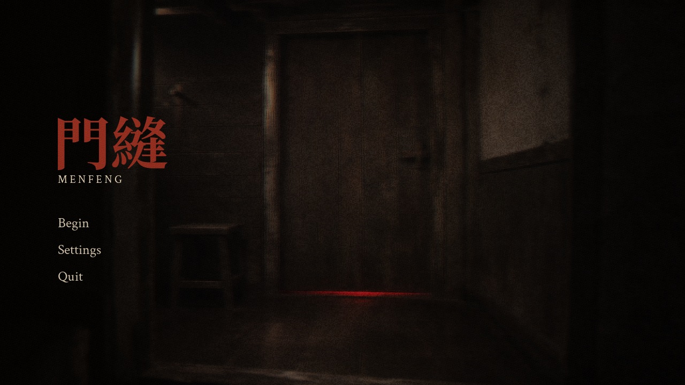
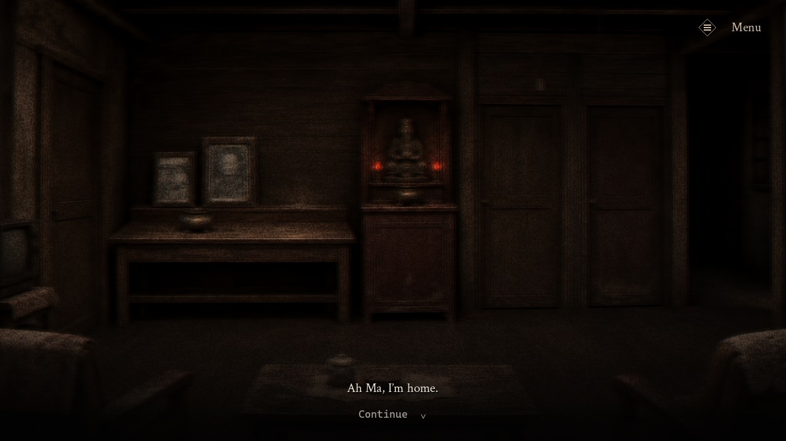
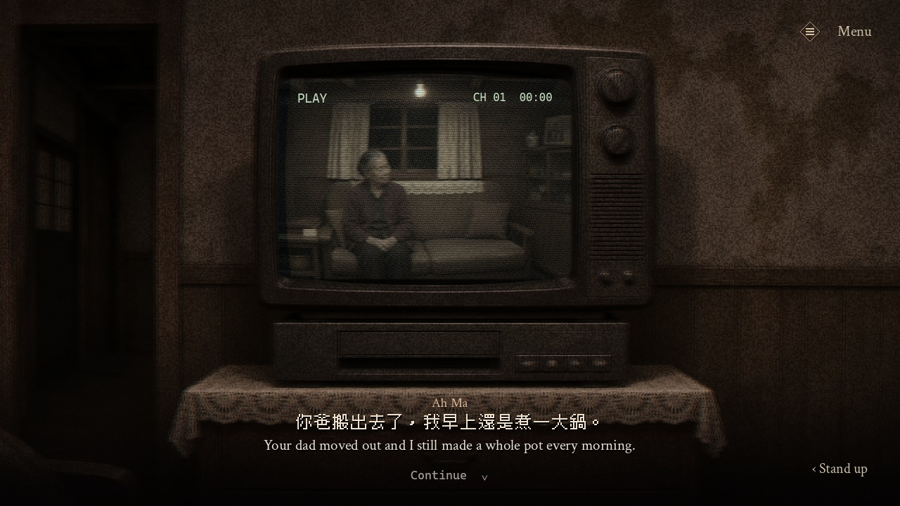

# 門縫 · MENFENG

A single-player point-and-click analog horror game by **Medissl Games**.

You missed Ah Ma’s funeral. By the time you reach her house in rural Taiwan, the rain has followed you all the way up the dirt road. Dad says she left you a tape. Inside, the ancestor altar is just as you remember it.

Explore the house, inspect what she left behind, and follow the recording one chapter at a time. Dialogue on the tape is presented in Traditional Chinese with English subtitles.

## Play on Windows

[Download MENFENG 1.0.0 for Windows x64](https://github.com/medissl/menfeng/releases/download/v1.0.0/MENFENG-1.0.0-Windows-x64.zip). Extract the ZIP and open `MENFENG.exe`. The game is free to play, runs offline, and requires no installer.

- **Left click** to inspect, move, or advance dialogue. A click during typing reveals the whole line.
- **I** opens the inventory when it’s available. Select an item and choose **Hold item** to use it in the house.
- **Esc** opens or closes the menu. Use **Replay last instruction** for Ah Ma’s last available directions.

The game depicts grief and disturbing ritual imagery and uses intermittent analog screen distortion and sudden sounds.

## Screenshots

| The ancestor hall | Ah Ma’s recording |
| --- | --- |
|  |  |

## Credits and rights

Created by **Medissl**. Built with Godot 4.7.2.

© 2026 Medissl. All rights reserved. See the [game license](LICENSE.txt) and [third-party notices](THIRD_PARTY_NOTICES.md).
